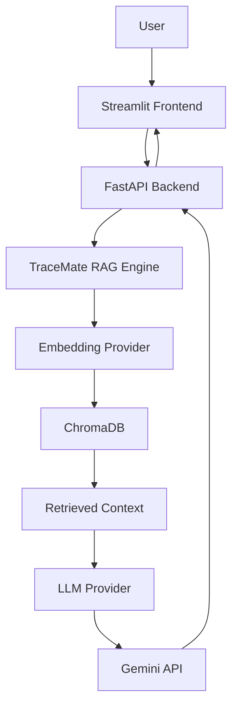

# TraceMate — Java DSA Learning Assistant

TraceMate is an AI-powered Java Data Structures and Algorithms (DSA) learning assistant built using Retrieval-Augmented Generation (RAG).

It combines a curated Java DSA knowledge base with an LLM to provide context-aware explanations, progressive hints, code reviews, and edge-case suggestions.

## Features

- **Concept explanations:** Understand Java DSA topics with examples and complexity analysis.
- **Progressive hints:** Receive hints at five levels without immediately revealing the complete solution.
- **Code analysis:** Get conceptual feedback on submitted Java code, including potential syntax and logical issues.
- **Edge-case generation:** Identify normal, boundary, and unusual test cases.
- **Knowledge retrieval:** Retrieve relevant information from a custom Markdown knowledge base using semantic search.
- **Configurable providers:** Provider interfaces allow the LLM and embedding implementations to be changed independently.

## Tech Stack

| Component | Technology |
|---|---|
| Language | Python 3.11+ |
| LLM | Google Gemini |
| Embeddings | Gemini Embedding |
| Vector database | ChromaDB |
| RAG pipeline | Custom Python implementation |
| Backend | FastAPI |
| Frontend | Streamlit |
| Configuration | Pydantic Settings |

## Architecture



## Project Structure

```text
TraceMate/
├── knowledge_base/
│   └── java/
│       ├── arrays.md
│       ├── linked_lists.md
│       └── binary_search.md
├── src/
│   └── tracemate/
│       ├── providers/
│       │   ├── base.py
│       │   ├── factory.py
│       │   └── gemini.py
│       ├── rag/
│       │   ├── loader.py
│       │   ├── chunker.py
│       │   ├── vector_store.py
│       │   ├── ingest.py
│       │   ├── retrieve.py
│       │   └── qa.py
│       ├── config.py
│       ├── api.py
│       ├── ask.py
│       └── smoke_test.py
├── streamlit_app.py
├── pyproject.toml
├── requirements.txt
├── .env.example
└── README.md
```

## Getting Started

### 1. Prerequisites

- Python 3.11 or newer
- A Gemini API key from [Google AI Studio](https://aistudio.google.com/)

### 2. Clone the repository

```bash
git clone https://github.com/ar-lw/TraceMate.git
cd TraceMate
```

### 3. Create a virtual environment

**Windows PowerShell:**

```powershell
py -3.11 -m venv .venv
.\.venv\Scripts\Activate.ps1
```

### 4. Install dependencies

```bash
python -m pip install --upgrade pip
pip install -e .
```

### 5. Configure environment variables

Create a `.env` file in the project root:

```env
GEMINI_API_KEY=your_gemini_api_key
LLM_PROVIDER=gemini
EMBEDDING_PROVIDER=gemini
```

Never commit your `.env` file or expose your API key.

### 6. Ingest the knowledge base

```bash
python -m tracemate.rag.ingest
```

This loads the Markdown documents, splits them into chunks, generates embeddings, and stores them in ChromaDB.

### 7. Start the backend

```bash
python -m uvicorn tracemate.api:app --reload
```

API documentation: http://127.0.0.1:8000/docs

Health check: http://127.0.0.1:8000/health

### 8. Start the frontend

Open a second terminal, activate the virtual environment, and run:

```bash
streamlit run streamlit_app.py
```

Streamlit will provide a local URL for the application.

## Learning Modes

| Mode | Description |
|---|---|
| Explain | Explains a Java DSA concept |
| Hint | Provides progressive hints from level 1 to 5 |
| Analyze | Reviews submitted Java code conceptually |
| Edge Cases | Suggests test cases for submitted code |

## API

**Endpoint:** `POST /ask`

Example request:

```json
{
  "question": "How do I reverse a linked list?",
  "mode": "hint",
  "code": "",
  "hint_level": 1
}
```

Example response:

```json
{
  "answer": "Start by considering how each node's next reference...",
  "sources": ["java/linked_lists.md"]
}
```

## Current Limitations

- The initial implementation uses Gemini for generation and embeddings.
- Ollama provider support is planned but not yet implemented.
- Code analysis is conceptual; TraceMate does not compile or execute submitted Java code.
- The knowledge base currently covers arrays, linked lists, and binary search.
- Response quality depends on the retrieved context and the underlying LLM.

## Future Improvements

- Add more Java DSA topics to the knowledge base.
- Implement Ollama-based local LLM and embedding providers.
- Improve retrieval evaluation and chunking.
- Add automated tests.
- Introduce conversation history and learning progress tracking.

## Purpose

TraceMate was built as a hands-on project to explore LLM integration, embeddings, vector databases, Retrieval-Augmented Generation, API development, and AI application architecture.