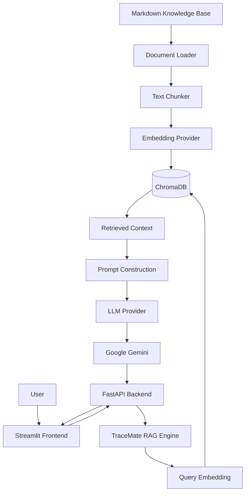

# TraceMate — Java DSA Learning Assistant

TraceMate is an AI-powered Java Data Structures and Algorithms (DSA) learning assistant built using **Retrieval-Augmented Generation (RAG)**.

It combines a curated Java DSA knowledge base with a Large Language Model (LLM) to provide context-aware explanations, progressive hints, conceptual code reviews, and edge-case suggestions.

The project was built to explore how LLMs, embeddings, vector databases, and retrieval pipelines can be combined to create practical AI applications.

## Features

- **Concept Explanations:** Understand Java DSA concepts with examples and time and space complexity analysis.
- **Progressive Hints:** Receive hints across five difficulty levels without immediately revealing the complete solution.
- **Code Analysis:** Get conceptual feedback on submitted Java code, including potential syntax errors, logical issues, and improvements.
- **Edge-Case Generation:** Identify normal, boundary, and unusual test cases for submitted code.
- **Knowledge Retrieval:** Retrieve relevant information from a custom Markdown knowledge base using semantic similarity search.
- **Configurable Providers:** Separate LLM and embedding provider interfaces make it easier to introduce alternative implementations.

## Tech Stack

| Component | Technology |
|---|---|
| Programming Language | Python 3.11+ |
| LLM | Google Gemini |
| Embedding Model | Gemini Embedding |
| Vector Database | ChromaDB |
| RAG Pipeline | Custom Python implementation |
| Backend | FastAPI |
| Frontend | Streamlit |
| Configuration | Pydantic Settings |
| Testing | pytest |

## Architecture

TraceMate uses two main pipelines.

**1. Knowledge Ingestion**

Markdown documents are loaded, divided into smaller chunks, converted into vector embeddings, and stored in ChromaDB.

**2. Question Answering**

A user's question is converted into an embedding, relevant knowledge chunks are retrieved from ChromaDB, and the retrieved context is passed to Gemini to generate a grounded response.



## Project Structure

```text
TraceMate/
│
├── knowledge_base/
│   └── java/
│       ├── arrays.md
│       ├── linked_lists.md
│       └── binary_search.md
│
├── src/
│   └── tracemate/
│       ├── providers/
│       │   ├── base.py
│       │   ├── factory.py
│       │   └── gemini.py
│       │
│       ├── rag/
│       │   ├── loader.py
│       │   ├── chunker.py
│       │   ├── vector_store.py
│       │   ├── ingest.py
│       │   ├── retrieve.py
│       │   └── qa.py
│       │
│       ├── config.py
│       ├── api.py
│       ├── ask.py
│       └── smoke_test.py
│
├── tests/
│   ├── test_abstract.py
│   ├── test_chunking.py
│   └── test_embedding_validation.py
│
├── streamlit_app.py
├── pyproject.toml
├── requirements.txt
├── .env.example
├── .gitignore
└── README.md
```

## Getting Started

### Prerequisites

- Python 3.11 or newer
- Google Gemini API key from [Google AI Studio](https://aistudio.google.com/)

### 1. Clone the repository

```bash
git clone https://github.com/ar-lw/TraceMate.git
cd TraceMate
```

### 2. Create a virtual environment

For Windows PowerShell:

```powershell
py -3.11 -m venv .venv
.\.venv\Scripts\Activate.ps1
```

### 3. Install dependencies

```powershell
python -m pip install --upgrade pip
pip install -e ".[dev]"
```

### 4. Configure environment variables

Create a `.env` file in the project root.

Add the following:

```env
GEMINI_API_KEY=your_gemini_api_key
LLM_PROVIDER=gemini
EMBEDDING_PROVIDER=gemini
```

Never commit your `.env` file or expose your API key.

### 5. Ingest the knowledge base

```powershell
python -m tracemate.rag.ingest
```

This command:

1. Loads Markdown documents from the knowledge base.
2. Splits documents into smaller chunks.
3. Generates embeddings.
4. Stores the embeddings and associated metadata in ChromaDB.

### 6. Start the backend

```powershell
python -m uvicorn tracemate.api:app --reload
```

The API will be available at:

- API: `http://127.0.0.1:8000`
- Interactive API documentation: `http://127.0.0.1:8000/docs`
- Health check: `http://127.0.0.1:8000/health`

### 7. Start the frontend

Open a second terminal, activate the virtual environment, and run:

```powershell
streamlit run streamlit_app.py
```

Streamlit will provide a local URL to access the application.

## Learning Modes

| Mode | Description |
|---|---|
| Explain | Explains Java DSA concepts with relevant examples. |
| Hint | Provides progressive hints from level 1 to 5. |
| Analyze | Reviews submitted Java code conceptually. |
| Edge Cases | Suggests test cases for submitted Java code. |

## API Usage

**Endpoint:** `POST /ask`

Example request:

```json
{
  "question": "How do I reverse a linked list?",
  "mode": "hint",
  "code": "",
  "hint_level": 1
}
```

Example response:

```json
{
  "answer": "Start by considering how each node's next reference can be changed...",
  "sources": [
    "java/linked_lists.md"
  ]
}
```

## Running Tests

TraceMate uses pytest for automated testing.

Run the test suite from the project root:

```powershell
pytest -v
```

The tests cover:

- Abstract provider implementation.
- Knowledge-base loading and chunk generation.
- Embedding validation, including dimensions and invalid numeric values.

## Current Limitations

- Gemini is currently used for both LLM generation and embeddings.
- Ollama provider support is planned but not yet implemented.
- Code analysis is conceptual; submitted Java code is not compiled or executed.
- The knowledge base currently covers arrays, linked lists, and binary search.
- Response quality depends on retrieval relevance and the underlying LLM.

## Future Improvements

- Expand the knowledge base to cover more Java DSA topics.
- Implement Ollama-based local LLM and embedding providers.
- Improve retrieval quality through evaluation, chunking experiments, and ranking strategies.
- Add conversation history and learning progress tracking.
- Introduce more comprehensive integration and end-to-end tests.

## Purpose

TraceMate was built as a hands-on learning project to understand the engineering behind LLM-powered applications.

The project explores:

- LLM integration and prompt engineering.
- Text embeddings and semantic search.
- Vector databases and persistent storage.
- Retrieval-Augmented Generation (RAG).
- Provider abstraction and modular architecture.
- REST API development with FastAPI.
- Interactive AI application development with Streamlit.
- Input validation and automated testing.

**Repository:** [github.com/ar-lw/TraceMate](https://github.com/ar-lw/TraceMate)